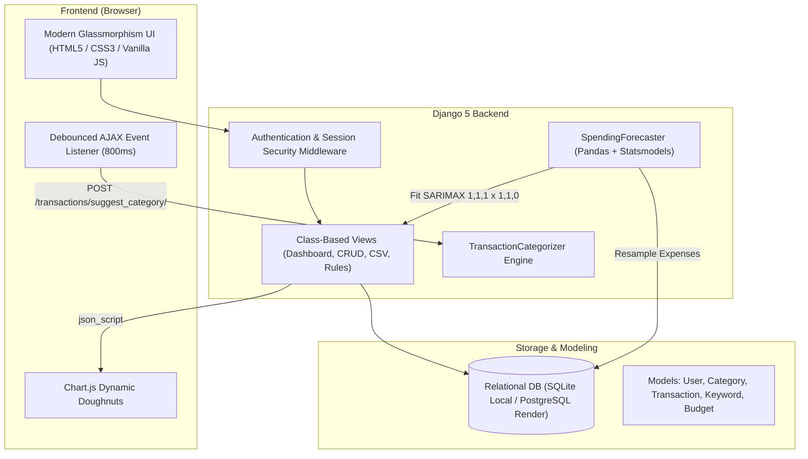

# 🎯 FinSight AI — Presentation & Demo Guide

> **Your Complete Step-by-Step Script for Project Demos, Technical Interviews & College Viva**

---

## 📑 Presentation Outline
1. **The Elevator Pitch (1 Minute)**
2. **System Architecture & Tech Stack**
3. **Click-by-Click Live Demo Script**
4. **Core Technical Innovations (Deep-Dive)**
5. **Tough Viva / Interview Questions & Crisp Answers**

---

## 1. 🎤 The Elevator Pitch (What to Say in the First 60 Seconds)

> *"Good morning/afternoon everyone. Today, I am presenting **FinSight AI**, an intelligent personal finance management web application.*
>
> *Most expense trackers on the market suffer from two major friction points:*
> 1. *Manual categorization is tedious — users have to pick dropdowns for every single transaction.*
> 2. *Existing tools are purely backward-looking: they tell you what you spent yesterday, but give zero foresight into what you will spend next month.*
>
> *FinSight AI solves both: it combines **asynchronous real-time auto-categorisation** as you type, and a statistical **SARIMA machine-learning time-series forecasting engine** that projects your next 30 days of spending with weekly seasonality. Let me walk you through how it works."*

---

## 2. 🏗️ High-Level System Architecture



---

## 3. 🎬 Click-by-Click Live Demo Script

Follow these exact steps when sharing your screen:

### **Step 1: The Login Screen (`/accounts/login/`)**
* **Action:** Open `http://127.0.0.1:8000/` (or `http://10.35.24.197:8000/` to show cross-device capability on your phone/other laptop).
* **Say:** *"We implemented session-based authentication with strict row-level user data isolation. Every user's transactions, budgets, and rules are private."*
* **Enter:** Username `admin`, Password `admin123`. Click **Login**.

---

### **Step 2: The Main Dashboard (`/`)**
* **Point to the Doughnut Chart:**
  * **Say:** *"Here is the category spending breakdown. It aggregates transactions on the backend via Django ORM `Sum('amount')` queries and securely passes JSON data using Django's `json_script` to prevent XSS attacks."*
* **Point to the Financial Forecast Card (Top Left):**
  * **Say:** *"Notice this projection: **₹81,531.09**. This is not a static number. Our backend uses a SARIMA time-series model fitted across the user's historical daily spending, factoring in weekly cyclical patterns."*
* **Point to the Monthly Budget Progress Bars (Bottom):**
  * **Say:** *"These budgets feature dynamic threshold alerts: Green when spending is below 75%, Yellow between 75% and 99%, and Red once a budget is exceeded."*

---

### **Step 3: The AI Categorization in Action (`/transactions/add/`)**
* **Action:** Click the top-right button **"+ Add New Transaction"**.
* **Action:** Type `"Zomato dinner with friends"` in the **Description** field and **pause for 1 second**.
* **Point out:** The **Category** dropdown automatically changes to **"Food & Dining"**!
* **Say:** *"Notice I did not touch the category dropdown. An asynchronous debounced AJAX request queried our categorization engine, parsed the text, and suggested the category automatically."*
* **Action:** Try another example: delete the text and type `"Uber ride to airport"` $\rightarrow$ It instantly switches to **"Transportation"**.
* **Action:** Enter Amount: `450.00`, leave date as pre-populated current timestamp, click **"Save Transaction"**.
* **Show Toast Message:** Notice the smooth green notification: *"Transaction saved successfully!"*

---

### **Step 4: Smart Rules Customization (`/transactions/rules/`)**
* **Action:** Click **"Smart Rules"** in the top navigation bar.
* **Say:** *"Users are not locked into our default dictionary. They can train custom keywords for their personal spending habits."*
* **Action:** Show an existing category (e.g. `Groceries`), add a new keyword (e.g. `swiggy instamart`), click **"+"**.
* **Say:** *"Now, any future transaction containing 'swiggy instamart' will automatically route to Groceries."*

---

### **Step 5: Budget Management (`/transactions/budgets/`)**
* **Action:** Click **"Budgets"** in the navbar.
* **Say:** *"Here, users can set monthly caps per category. Submitting updates updates or creates entries cleanly using Django's `update_or_create` ORM method."*

---

### **Step 6: Data Export (`/transactions/export/csv/`)**
* **Action:** Return to **Dashboard** and click **"Download"** (CSV button).
* **Say:** *"We provide instant data portability. The backend streams a CSV with strict date, description, category, type, and amount headers for Excel or financial audit tools."*

---

## 4. 🧠 Deep-Dive: How to Explain the AI & ML Code

If the evaluator asks: *"Show me the AI code"*, open **[`transactions/forecaster.py`](file:///Users/aditya/Downloads/FINSIGHT_AI-main/transactions/forecaster.py)**:

### **Point 1: Time Series Resampling (Pandas)**
```python
df['date'] = pd.to_datetime(df['date'])
df.set_index('date', inplace=True)
daily_spending = df['amount'].astype(float).resample('D').sum().fillna(0)
```
* **Explanation:** *"Raw transactions happen at random hours. We resample them into a continuous daily time-series $\text{D}$, filling zero-spending days with 0 so the statistical model has an unbroken timeline."*

### **Point 2: SARIMAX Modeling (Statsmodels)**
```python
model = sm.tsa.statespace.SARIMAX(
    daily_data,
    order=(1, 1, 1),             # (p, d, q) non-seasonal
    seasonal_order=(1, 1, 0, 7), # (P, D, Q, s) weekly seasonality
    enforce_stationarity=False,
    enforce_invertibility=False
)
results = model.fit(disp=False)
forecast = results.get_forecast(steps=30)
```
* **Explanation:**
  * **$s=7$:** Represents the 7-day weekly cycle in human finance.
  * **$d=1, D=1$:** First-order differencing to achieve stationarity (removing trend).
  * **Fallback:** *"If a new user has fewer than 30 days of records, we gracefully fall back to an average daily spend projection ($\overline{x} \times 30$) until enough seasonal data is accumulated."*

---

## 5. 💡 Top Viva / Interview Questions & Model Answers

### **Q1: Why did you use SARIMA instead of Deep Learning (like LSTM) for forecasting?**
> **Answer:** *"For personal expense tracking, users typically have dozens or hundreds of records, not millions. LSTMs and neural networks severely overfit on small sample sizes and require heavy GPUs. SARIMA is mathematically rigorous, computationally lightweight, handles 7-day seasonality natively, and executes in milliseconds directly inside our web request cycle."*

### **Q2: Why use a rule-based categorizer rather than a Naive Bayes or LLM API?**
> **Answer:** *"Rule-based classification provides three crucial advantages: zero latency (<15ms response for debounced typing), 100% explainability (no hallucinated categories), and zero API cost. Users also have full transparency to view and edit their rules on the Smart Rules page."*

### **Q3: How do you prevent cross-user data leaks?**
> **Answer:** *"Every query in our views explicitly filters on `user=request.user`. In `UpdateTransactionView` and `DeleteTransactionView`, we override `get_queryset()` to return `Transaction.objects.filter(user=self.request.user)`, so attempting to access another user's ID throws a clean `404 Not Found` rather than a permission leak."*

### **Q4: How did you solve the browser 'Confirm Form Resubmission' (ERR_CACHE_MISS) issue?**
> **Answer:** *"We implemented the Post/Redirect/Get (PRG) pattern. Whenever a form is successfully posted, the view responds with an `HttpResponseRedirect` to `dashboard` and leverages Django's messages framework to display feedback toasts, ensuring the browser back and refresh buttons never re-trigger POST submissions."*

### **Q5: How does this project scale to production?**
> **Answer:** *"The architecture is stateless and container/cloud ready via `render.yaml`. We decouple configurations through environment variables (`python-decouple`), serve compressed static files with `WhiteNoise`, support PostgreSQL via `dj-database-url`, and run behind `gunicorn`."*
