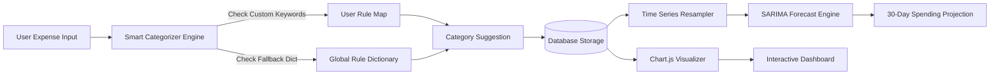
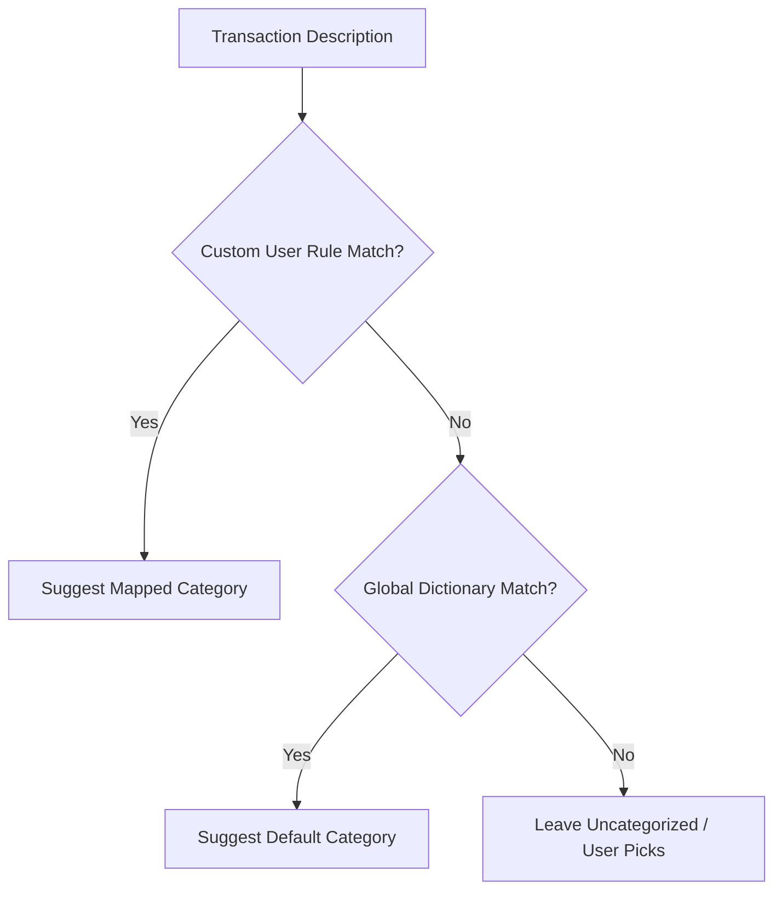

<div align="center">

# 💰 FinSight AI (ExpenseTrack)

### *Intelligent Personal Finance Tracker with Automated Categorisation & 30-Day Spending Forecasts*

[](https://www.djangoproject.com/)
[](https://www.python.org/)
[](https://pandas.pydata.org/)
[](https://www.statsmodels.org/)
[]()
[]()

<br/>

[🚀 Live Demo](https://finsight-ai-web.onrender.com) • [✨ Features](#-key-features) • [⚡ Quickstart](#-quickstart-guide) • [🧠 AI & Forecasting Engine](#-how-the-ai--forecasting-engines-work) • [🧪 Tests](#-test-suite) • [📚 API Reference](#-internal-api-endpoints)

</div>

---

## 📖 Overview

**FinSight AI** is a production-grade personal financial tracking platform built with **Django 5**, **Pandas**, and **Statsmodels**. It bridges backend web development and data science by pairing explainable rule-based transaction auto-categorisation with a statistical **SARIMA** (Seasonal Autoregressive Integrated Moving Average) time-series spending forecast.



---

## ✨ Key Features

| Category | Capability | Details |
|:---|:---|:---|
| 🔐 **Authentication** | Secure User Isolation | Session-based registration, login, and strict row-level user data isolation |
| ⚡ **Smart Categorisation** | Dual-Tier Suggestion Engine | Real-time autocomplete suggestions via personal keyword rules + fallback knowledge base |
| 📈 **Predictive AI** | 30-Day SARIMA Forecast | Models 7-day weekly spending seasonality with fallback to average daily spend |
| 📊 **Visual Analytics** | Interactive Doughnut Charts | Real-time expense breakdown dynamically powered by Chart.js and Django ORM aggregations |
| 🎯 **Budget Control** | Threshold-Aware Alerts | Visual progress meters with dynamic status coding: 🟢 Safe (<75%), 🟡 Warning (75-99%), 🔴 Danger (≥100%) |
| 💾 **Data Portability** | Instant CSV Export | One-click export for spreadsheet analysis (Excel, Google Sheets, Pandas) |
| 🛡️ **Defensive Engineering** | Post/Redirect/Get Flow | Zero form-resubmission glitches, CSRF protection, and unified toast notification system |

---

## ⚡ Quickstart Guide

Get FinSight AI up and running locally in under 3 minutes:

### 1. Clone the Repository
```bash
git clone https://github.com/adityadhimaann/expensetrack.git
cd expensetrack
```

### 2. Set Up Virtual Environment

<details open>
<summary><b>macOS / Linux</b></summary>

```bash
python3 -m venv venv
source venv/bin/activate
```
</details>

<details>
<summary><b>Windows (Command Prompt / PowerShell)</b></summary>

```bat
python -m venv venv
venv\Scripts\activate
```
</details>

### 3. Install Dependencies
```bash
pip install --upgrade pip
pip install -r requirements.txt
```

### 4. Configure Environment Variables
Create a `.env` file in the project root:
```bash
cp .env.example .env
```
*(A default secret key is automatically provided in `.env.example`).*

### 5. Apply Database Migrations
```bash
python manage.py migrate
```

### 6. Populate Realistic Demo Data *(Recommended)*
We have built-in realistic mock data covering 90+ days of transactions, smart rules, and monthly budgets:
```bash
python manage.py seed_data --clear
```

> **Default Seed Credentials:**
> - **Username:** `admin`
> - **Password:** `admin123`

### 7. Launch Development Server
```bash
python manage.py runserver
```
Visit **[http://127.0.0.1:8000/](http://127.0.0.1:8000/)** in your browser!

---

## 🧠 How the AI & Forecasting Engines Work

### 1. Rule-Based Categorisation Engine
Rather than using opaque black-box classifiers that make unpredictable suggestions on short descriptions, FinSight uses an explainable dual-stage matching pipeline:



- **Priority 1 (Custom Rules):** Maps personal keywords defined by the user (e.g. `dps fee` ➔ `Education`, `haldiram` ➔ `Food`).
- **Priority 2 (Global Dictionary):** Fallback dictionary containing popular merchants (Zomato, Swiggy, Uber, Netflix, Apollo Pharmacy, etc.).

### 2. SARIMA 30-Day Spending Projection
In [forecaster.py](file:///Users/aditya/Downloads/FINSIGHT_AI-main/transactions/forecaster.py), transactions are aggregated into a daily time series via Pandas:

$$\text{Daily Spending} = \sum_{t \in \text{Day}} \text{Amount}_t$$

- **History $\ge$ 30 days:** Fits a **$\text{SARIMAX}(1, 1, 1) \times (1, 1, 0)_7$** model capturing weekly spending spikes (e.g., higher weekend entertainment/dining).
- **History $<$ 30 days:** Gracefully falls back to a 30-day projection based on historical average daily spending:
  $$\text{Forecast} = \overline{\text{Daily Spend}} \times 30$$

---

## 🧪 Test Suite

FinSight AI comes equipped with a comprehensive **30-test suite** verifying data isolation, edge cases, APIs, and the statistical engine.

```bash
python manage.py test core transactions --verbosity=2
```

<details>
<summary><b>View Test Suite Coverage Details (30/30 Passing)</b></summary>

```
test_anonymous_user_redirected_to_login (core.tests.DashboardViewTests) ... ok
test_authenticated_user_accesses_dashboard_empty_state (core.tests.DashboardViewTests) ... ok
test_budget_progress_color_classes (core.tests.DashboardViewTests) ... ok
test_dashboard_with_transactions_and_budgets (core.tests.DashboardViewTests) ... ok
test_signup_page_renders_correctly (core.tests.SignUpViewTests) ... ok
test_signup_password_mismatch_shows_error (core.tests.SignUpViewTests) ... ok
test_signup_successful_creates_user_and_redirects (core.tests.SignUpViewTests) ... ok
test_add_category_invalid_json (transactions.tests.AddCategoryViewAPITests) ... ok
test_add_category_success (transactions.tests.AddCategoryViewAPITests) ... ok
test_add_duplicate_category_fails (transactions.tests.AddCategoryViewAPITests) ... ok
test_anonymous_redirected_to_login (transactions.tests.AddTransactionViewTests) ... ok
test_get_add_transaction_page (transactions.tests.AddTransactionViewTests) ... ok
test_post_add_transaction_invalid (transactions.tests.AddTransactionViewTests) ... ok
test_post_add_transaction_success (transactions.tests.AddTransactionViewTests) ... ok
test_export_csv_view (transactions.tests.ExportCSVTests) ... ok
test_add_and_delete_keyword_rule (transactions.tests.ManageRulesAndBudgetsViewTests) ... ok
test_manage_budgets_get_and_post (transactions.tests.ManageRulesAndBudgetsViewTests) ... ok
test_category_creation_and_uniqueness (transactions.tests.ModelAndFormTests) ... ok
test_transaction_form_filters_user_categories (transactions.tests.ModelAndFormTests) ... ok
test_empty_transactions_returns_none (transactions.tests.SpendingForecasterUnitTests) ... ok
test_long_history_uses_sarima_model (transactions.tests.SpendingForecasterUnitTests) ... ok
test_short_history_uses_daily_average (transactions.tests.SpendingForecasterUnitTests) ... ok
test_suggest_category_custom_keyword (transactions.tests.SuggestCategoryViewAPITests) ... ok
test_suggest_category_default_fallback (transactions.tests.SuggestCategoryViewAPITests) ... ok
test_suggest_category_empty_description (transactions.tests.SuggestCategoryViewAPITests) ... ok
test_suggest_category_no_suggestion (transactions.tests.SuggestCategoryViewAPITests) ... ok
test_non_owner_cannot_delete_transaction (transactions.tests.UpdateAndDeleteTransactionViewTests) ... ok
test_non_owner_cannot_update_transaction (transactions.tests.UpdateAndDeleteTransactionViewTests) ... ok
test_owner_can_delete_transaction (transactions.tests.UpdateAndDeleteTransactionViewTests) ... ok
test_owner_can_update_transaction (transactions.tests.UpdateAndDeleteTransactionViewTests) ... ok

----------------------------------------------------------------------
Ran 30 tests in 4.781s

OK
```
</details>

---

## 📚 Internal API Endpoints

| Method | Endpoint | Description | Request Payload | Response |
|:---|:---|:---|:---|:---|
| `POST` | `/transactions/suggest_category/` | Get AI category suggestion | `{"description": "uber ride"}` | `{"status": "success", "category_id": 3}` |
| `POST` | `/transactions/add_category/` | Create custom category inline | `{"name": "Fitness"}` | `{"status": "success", "category_id": 12, "category_name": "Fitness"}` |
| `GET` | `/transactions/export/csv/` | Download CSV records | *None* | `text/csv` Attachment |
| `POST` | `/transactions/rules/` | Add/delete smart keyword rule | Form data: `action`, `category_id`, `keyword_text` | Redirect with Toast Message |
| `POST` | `/transactions/budgets/` | Save category limits | Form data: `budget_<category_id>` | Redirect with Toast Message |

---

## 🗂️ Project Directory Structure

```
expensetrack/
├── core/                       # Core application (Dashboard, Authentication)
│   ├── templates/              # HTML templates (Login, Signup, Dashboard)
│   ├── views.py                # Dashboard & Signup class-based views
│   ├── tests.py                # Dashboard & Auth test suite
│   └── urls.py                 # Core routing
├── transactions/               # Finance logic & modeling
│   ├── categorizer.py          # Dual-tier rule matching engine
│   ├── forecaster.py           # SARIMA time-series spending forecaster
│   ├── forms.py                # Transaction & Category ModelForms
│   ├── models.py               # Transaction, Category, Keyword, Budget models
│   ├── management/commands/    # Management CLI commands (seed_data, etc.)
│   ├── templates/              # Transaction management & CRUD templates
│   ├── tests.py                # 23 comprehensive transactions unit tests
│   └── views.py                # CRUD views & JSON API endpoints
├── finsight_project/           # Django project root configuration
│   ├── settings.py             # Settings, WhiteNoise, Database & Auth configuration
│   └── urls.py                 # Root URL configuration
├── static/                     # CSS stylesheets, UI glassmorphic styles
├── render.yaml                 # Blueprint configuration for Render deployment
├── requirements.txt            # Python dependencies
└── manage.py                   # Django CLI entrypoint
```

---

## ☁️ Deployment on Render

This project is pre-configured for one-click deployment using `render.yaml`:
1. Fork or push this repository to your GitHub account.
2. In the Render Dashboard, select **New +** ➔ **Blueprint**.
3. Connect your repository. Render automatically:
   - Provisions a managed PostgreSQL database.
   - Installs all dependencies.
   - Compiles static assets with WhiteNoise (`collectstatic`).
   - Runs database migrations (`python manage.py migrate`).
   - Boots Gunicorn production WSGI server.

---

## 📄 License

This project is licensed under the **MIT License**. Feel free to use, modify, and distribute.

<div align="center">
<sub>Designed & Developed with ❤️ by <a href="https://github.com/adityadhimaann">Aditya Dhiman</a></sub>
</div>